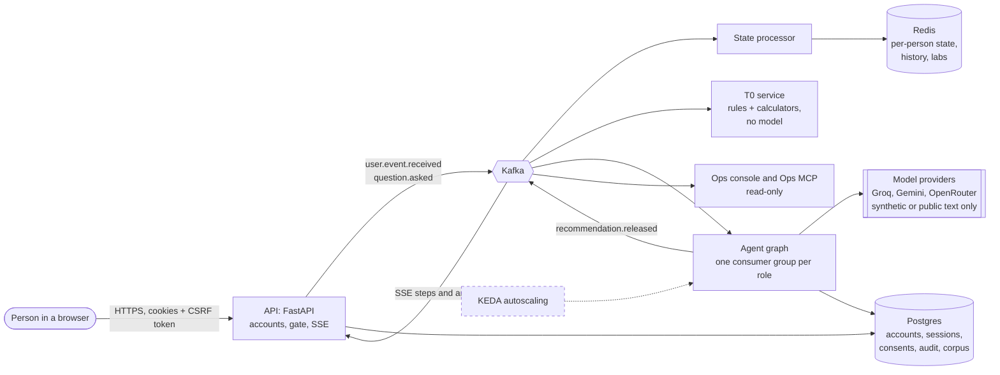
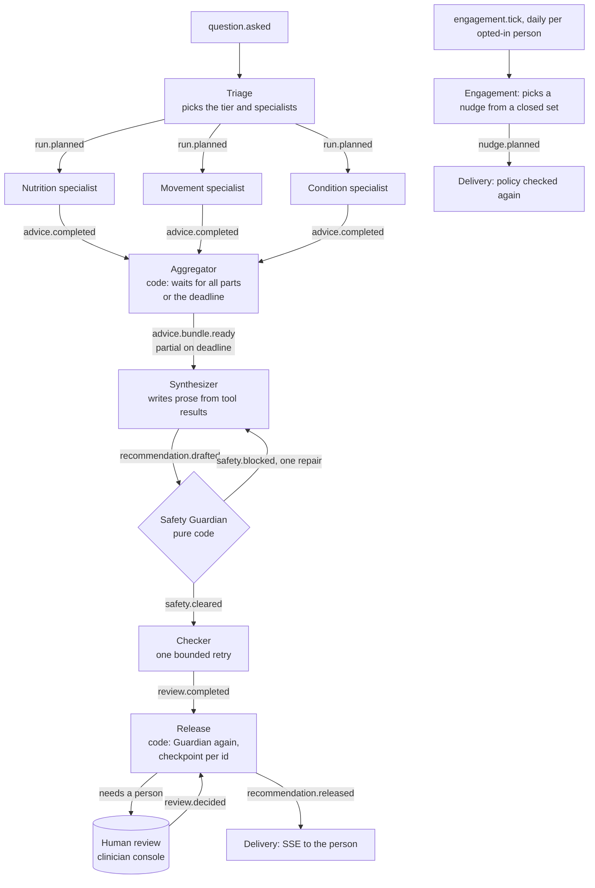
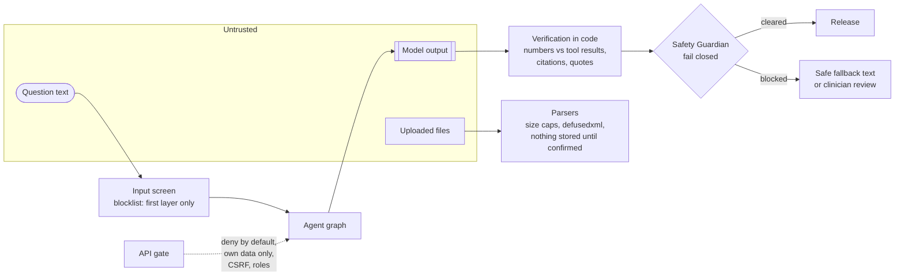
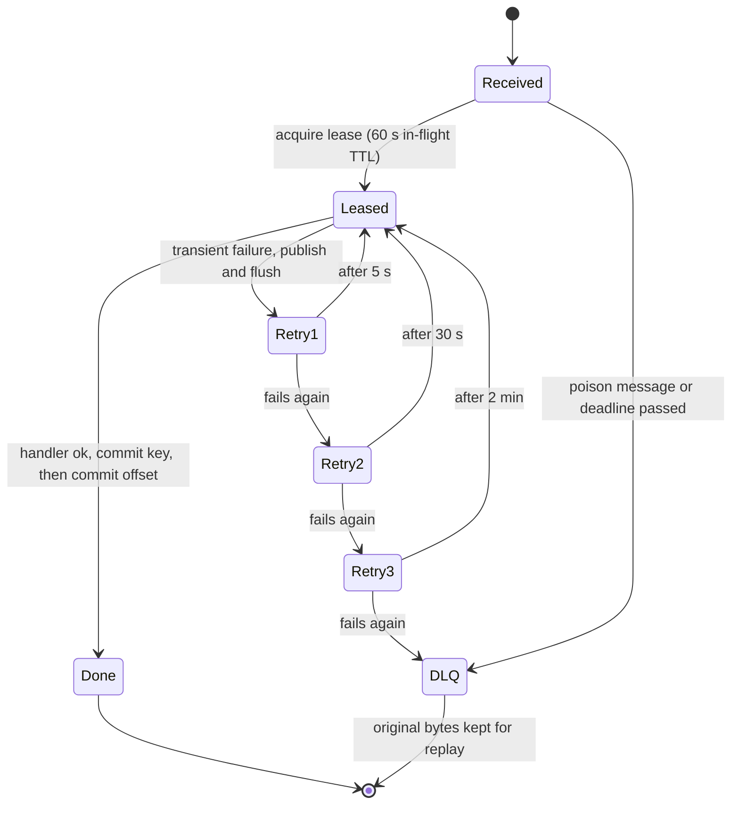
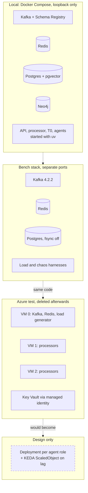

# VitalMesh diagrams

Five pictures of the system as it is built. Names match the code (`libs/common/.../topics.py`, `services/agents`). Boxes drawn with a dashed border are **design only** (described, not deployed). These render on GitHub; the same content is described in words in [ARCHITECTURE.md](ARCHITECTURE.md) and [EVENT_BACKBONE.md](EVENT_BACKBONE.md).

## 1. The system at a glance

Everything between services travels over Kafka. The API never calls an agent directly, and no agent calls another.

## 2. One question through the multi-agent graph (T3)

Each box is its own consumer group and can run as its own process. The Guardian is plain code, runs twice (at drafting and at release) and is the last gate.

## 3. Who is trusted, and where the checks are

The model is untrusted. Numbers come from tools, text is verified in code, and the Guardian cannot be bypassed by a prompt.

## 4. Delivery: retries, the dead-letter queue and the lease

At-least-once delivery with idempotent handlers. A crash anywhere re-delivers the record; the lease stops two workers doing the same event.

## 5. Where it runs

The development stack is Docker Compose on one machine. The Azure run (three small VMs, 2026-11-08) was a measurement and was deleted afterwards; the Kubernetes parts are a design.

